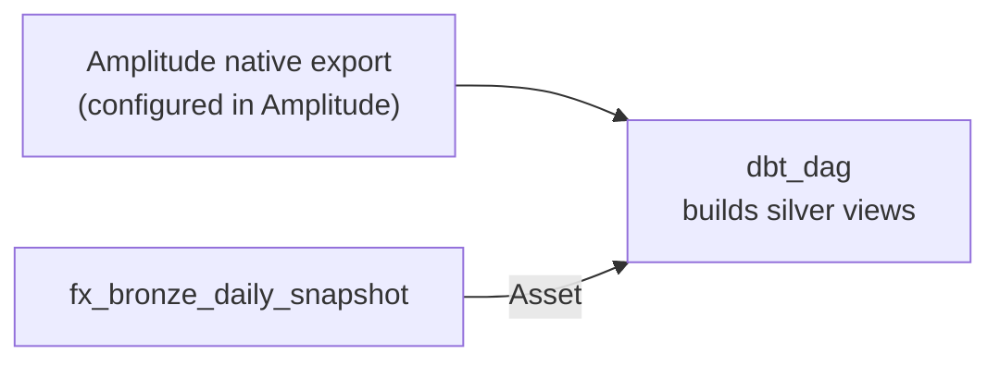
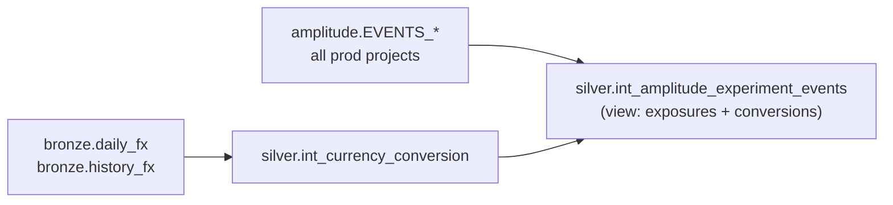

# Amplitude silver models: data flow and decisions

`int_amplitude_experiment_events` is a PII-free view of Amplitude experiment exposures and
conversion events. It was built for GrowthBook's experiment analysis, which the team no longer uses, so nothing in the
GrowthBook pipeline reads it or depends on it. The two pipelines are unrelated. The source is Amplitude's native
BigQuery export, which Amplitude writes hourly, outside Airflow. It reads every prod Amplitude
project through the `events_all` wildcard source (`EVENTS_*`, in `models/bronze/amplitude.yml`), so
new projects and experiments are picked up without config changes. It is not tied to
`seed_product_registry`, so it never affects the user journey mart. Time and device rules match
`silver/journey/int_amplitude_events`.

## DAG flow

## Table flow

## Filter decisions

Filters run inside the view on its source tables.

| Applied in | On table | Filter | Why |
|---|---|---|---|
| `silver.int_amplitude_experiment_events` | `amplitude` source `events_all` (`EVENTS_*`) | Read every prod project (not `amplitude_stage`) | Staging is test traffic. The wildcard picks up new projects automatically |
| `silver.int_amplitude_experiment_events` | `amplitude` source `events_all` (`EVENTS_*`) | `event_type` in `[Experiment] Exposure`, `purchase`, `purchase_failed`, `trial_started`, `subscription_converted`, `subscription_cancel` | Exposures say who saw which variant. `purchase` was the primary metric; the rest were for future metrics |
| `silver.int_amplitude_experiment_events` | `amplitude` source `events_all` (`EVENTS_*`) | `device_id` set to null when `platform = 'node'` | Server events carry a synthetic device id (same rule as `int_amplitude_events`) |
| `silver.int_amplitude_experiment_events` | `amplitude` source `events_all` (`EVENTS_*`) | Keep rows with `device_id` **or** `user_id` | A row needs an identifier. `subscription_converted` is 100% server-side and only has `user_id` |
| `silver.int_amplitude_experiment_events` | `amplitude` source `events_all` (`EVENTS_*`) | `timestamp` = `event_time`, or `server_received_time` when they're more than `amplitude_max_clock_skew_hours` (48) apart | Device clocks range from 1978 to 2042. No events are dropped (same rule as `int_amplitude_events`) |
| `silver.int_amplitude_experiment_events` | `amplitude` source `events_all` (`EVENTS_*`) | No `event_properties` passed through; only flag key, variant, price and currency are extracted | Purchase events contain PII (email, names, postal code) |
| `silver.int_amplitude_experiment_events` | `amplitude` source `events_all` (`EVENTS_*`) | Deduplicate: keep one row per `uuid` + `event_time` (exposed as `event_id`) | The export loads 0.3–0.8% of events twice (exact copies) |
| `silver.int_amplitude_experiment_events` | `amplitude` source `events_all` (`EVENTS_*`) | `amplitude_project_id` = `_TABLE_SUFFIX` | Per-project breakdowns and debugging |
| `silver.int_amplitude_experiment_events` | `amplitude` source `events_all` (`EVENTS_*`) | `event_category` = `exposure` for `[Experiment] Exposure`, else `conversion` | Labels each row so queries and tests can filter by row kind |
| `silver.int_amplitude_experiment_events` | `amplitude` source `events_all` (`EVENTS_*`) | `control`→`0`, `test`→`1`, `b`/`c`/`d`/`e`→ same letter (exposure rows) | The variation keys the experiments use (0 = control, 1 = test, letters for multi-arm experiments such as `default-video-model`). A test fails on any other value |
| `silver.int_amplitude_experiment_events` | `silver.int_currency_conversion` | Join on event date + currency; `amount_usd` = price × rate (conversion rows) | Same FX convention as other revenue models. Price is missing on about 65% of purchases |

## Tests on `silver.int_amplitude_experiment_events`

Two singular tests in `dags/dbt/bigquery_dbt/tests/`. Row checks cover the last 3 days, but the view scans every Amplitude project table in full on every query (about 4.6 GB today), because `timestamp` is computed and BigQuery can't prune partitions on it. If that cost grows, switch the model to an incremental table partitioned on `timestamp`. The column contract (in `schema.yml`) also fails the build if a column is added, removed or retyped, which guards against PII.

| File | Severity | `failure_reason` | Fails when |
|---|---|---|---|
| `test_amplitude_experiment_events_quality.sql` | error | `no_events_in_100h` | No new event in 100h, meaning the Amplitude export stopped (it exports hourly) |
| | | `duplicate_event_id` | Duplicates got through |
| | | `missing_required_field` | `event_id`, `amplitude_project_id`, `event_category` or `event_type` is empty, or a row has neither `device_id` nor `user_id` |
| | | `exposure_missing_device_id` | Exposure row without `device_id` (client events are assigned by device) |
| | | `exposure_missing_experiment_or_variant` | Exposure row without `experiment_id` or `variation_id` |
| | | `unexpected_value` | Unknown `event_category`, `event_type` or `variation_id` (e.g. a new variant name) |
| | | `exposure_with_amount` / `conversion_with_experiment` | Row kinds mixed up |
| | | `negative_amount_usd` | Broken price or FX |
| `test_amplitude_experiment_events_usd_currency_coverage.sql` | warn | n/a | A price can't be converted because the currency is missing from `int_currency_conversion` |
