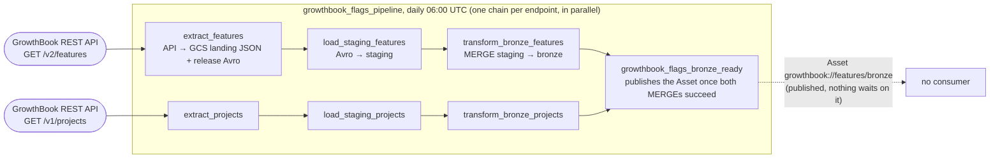
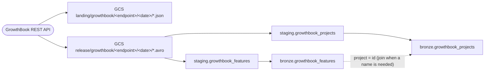

# GrowthBook flags pipeline: data flow and decisions

`growthbook_flags_pipeline` copies GrowthBook's feature flags, and the projects they belong to, into BigQuery every day. The
team uses GrowthBook only to create and manage feature flags, so these are the only GrowthBook data landed. A flag carries
only its project id, so the projects table is where the project name comes from. Every run takes a full snapshot of every flag
and project, so ones that people add or change in GrowthBook flow down with no code or config change.

## DAG flow



The two chains do not depend on each other: a failing projects call does not hold back the flags.

## Table flow



| Table | One row = | Key | Over time |
|---|---|---|---|
| `bronze.growthbook_features` | a feature flag | `id` (the flag key) | overwritten with the latest state, only by newer data |
| `bronze.growthbook_projects` | a GrowthBook project | `id` (`prj_…`) | overwritten with the latest state, only by newer data |

Flag columns: `id`, `description`, `owner` (user id), `project` (a project id, see below), `value_type`, `default_value`, `archived`, `tags`,
`targeting_all_projects`, `targeting_projects`, `prerequisites` (flag ids), `date_created`, `date_updated`,
`revision_version` (the flag's version number, up by one for each published change; 1 = never changed), `revision_date`
(when that version was published), `revision_comment` (the note typed when publishing), `environments` (JSON: `enabled` and
`defaultValue` per environment) and `rules` (JSON array: `type`, `enabled`, scope, served `value`, `coverage`, `hashAttribute`, and
for experiment rules the `experimentId` and variations), plus the usual `_elt_*` and `_gcs_file_path` columns.

Project columns: `id`, `name`, `description`, `public_id`, `allow_targeting`, `owner` (user id), `date_created`, `date_updated`,
plus the `_elt_*` and `_gcs_file_path` columns.

**Getting a flag's project name** (a flag stores only the project id):

```sql
SELECT p.name AS project, f.id AS flag, f.value_type
FROM `<project>.<bronze dataset>.growthbook_features` f
LEFT JOIN `<project>.<bronze dataset>.growthbook_projects` p ON p.id = f.project
```

## Code

| File | Role |
|---|---|
| `include/config/growthbook_settings.py` | Endpoints (API path + record key for features and projects), extra query params, Avro schema, rate limit (25/min for each of the two extract tasks, 50 combined, under GrowthBook's 60), timeouts |
| `include/custom_hooks/growthbook/base.py` | Bearer auth; offset pagination (`hasMore` / `nextOffset`) that fails rather than return a partial snapshot; retries 429/5xx and network errors with backoff; 401/403 fail the task at once; logs every call to `monitoring.api_requests` |
| `include/custom_operators/growthbook/growthbook_to_gcs_operator.py` | Writes raw pages to landing and one Avro row per record to release (always, even when empty) |
| `include/sql/growthbook/merge_features.sql`, `merge_projects.sql` | Create table if missing, add new columns, shred `raw_data` into typed columns, keep the newest row per `id`, upsert. The features file also redacts rules and environments |
| `dags/growthbook/growthbook_flags_pipeline.py` | The DAG |
| `dags/dbt/bigquery_dbt/models/bronze/growthbook.yml` | dbt source for both tables (no generic tests, see the decision below) |
| `dags/dbt/bigquery_dbt/macros/source_table_exists.sql` | Lets a dbt test skip a source table that the DAG has not created yet |

## Decisions

| Decision | Why |
|---|---|
| Flags, plus the projects they refer to | The team uses GrowthBook only to create flags (confirmed with Borys, 2026-10-20), so nothing else from GrowthBook is landed except the project lookup a flag needs for its name |
| Project name is a join, not a copy in the flags table | A project rename does not touch its flags' `date_updated`, and the MERGE only rewrites a flag when that date moves, so a copied name would go stale. One of the 14 projects had already been renamed |
| Projects store `owner` (user id) but not `ownerEmail` or `settings` | `ownerEmail` is personal data (it was the only field with an email), and `settings` is empty today and free-form. Same rule as for flags |
| `GET /v2/features`, not `/v1/features` | v1 is deprecated; v2 returns the rules as one top-level array |
| `archived=true` passed | The list leaves archived flags out by default; the `archived` column tells them apart |
| Full snapshot every run, no checkpoint | The API has no incremental cursor and the payload is small (a few calls per run) |
| Latest state, no history | Same as the other latest-state tables. `revision_version` and `revision_date` show how often a flag changes. Keeping every daily snapshot would need a history table |
| MERGE only overwrites with newer data | `WHEN MATCHED AND (T.date_updated IS NULL OR S.date_updated >= T.date_updated)`, so re-running a past day's task cannot roll a flag back |
| Rule targeting and environment definitions dropped | Rule `condition`, `savedGroupTargeting` and `prerequisites` can hold user ids or emails (QA allowlists), and an environment's `definition` is the compiled copy. Environment names are not fixed, so `definition` is blanked by a regex over the serialized JSON |
| `owner` stored as the user id (nulled if it contains `@`); `ownerEmail`, custom fields and who published a revision are not | Personal data, or free-form fields that might hold it. `owner` is free text in the API, so an email-shaped value is nulled in both tables (all 4 owners seen on 2026-10-21 were `u_` ids). Raw landing JSON and staging still contain what the API sent, like other sources |
| Deleted flags stay with their last state | The API only lists existing flags. Every run refreshes `_elt_update_timestamp` for those, so a flag whose timestamp stops moving was deleted |
| Never blocks other DAGs | `dbt_dag` does not wait on the Asset (do not add it to `dbt_dag`'s schedule: that list is an AND); tasks run in `standard_mem_pool` with a 30-minute timeout |
| API key read at run time (`{{ var.value.GROWTHBOOK_API_KEY }}`) | Parsing the DAG, locally or in CI, needs no secret; Airflow masks `*api_key*` values |
| Release Avro written even when empty, but an empty snapshot fails the extract task | The raw evidence is kept, and the staging load always finds a file. GrowthBook returning zero flags would otherwise pass every step and leave bronze stale with nothing to say so (for example when the key's access changes). The check applies to both endpoints; if GrowthBook can legitimately have no flags or no projects, remove or narrow it in `growthbook_to_gcs_operator.py` |
| A truncated fetch fails the task | Hitting the page cap, or a page saying `hasMore` with no `nextOffset`, raises instead of landing a snapshot that silently lacks the rest |
| 401/403 fail without retrying | A rejected or expired key cannot fix itself, so Airflow's 3 retries at 5 minutes each would only delay the failure by 15 minutes |
| Missing or malformed `rules` land as NULL | Not as a valid-looking `[]`, so the quality test reports them as a wrong shape |
| Daily at 06:00 UTC | Flags change at any time and nothing depends on when this runs |
| No freshness or staleness alerts | Flags are not created on a schedule, so a quiet source is normal. Only the two quality tests (warn) remain |
| dbt tests skip a table that does not exist yet | The tables are created by this DAG's first run, but `dbt_observability` runs `dbt test` on the whole project after every `dbt_dag` run, and the release PR's `dbt-test` job reads prod bronze. A test on a missing table is a "Not found" error, which `severity: warn` does not cover. The quality tests return no rows until their table exists, and the generic `id` tests were dropped because they cannot be guarded (the quality tests check duplicate ids, and the tables declare `id NOT NULL`) |
| The rate limit is split between the two extract tasks | The limiter is per process and the two extract tasks run at the same time, so each task gets half of GrowthBook's 60 requests a minute |
| No silver or gold model yet | Nobody has said what to do with the flags. The source is declared in dbt so a model can read it later. For now the project name comes from the join above |

## Tests

| Test | Checks |
|---|---|
| `tests/include/custom_hooks/growthbook/test_growthbook_base.py` | Auth header, pagination (a truncated fetch fails), extra params, retries, 401/403 fail without retrying |
| `tests/include/custom_operators/growthbook/test_growthbook_to_gcs_operator.py` | Landing/release files, empty Avro, date folder (including runs with no data interval), an empty snapshot fails, hook built with the endpoint's params |
| `tests/dags/test_growthbook_flags_pipeline.py` | Task wiring for the features and projects chains (independent of each other), Asset after both MERGEs, API key templated |
| `tests/sql/test_growthbook_merge_sql.py` | Both MERGEs: dedup key = MERGE key, null keys skipped, newer-wins guard. Features: rule targeting, feature-level prerequisite conditions and environment definitions dropped, no personal fields. Projects: no `ownerEmail` or `settings`. Both: email-shaped `owner` nulled |
| `dags/dbt/bigquery_dbt/tests/test_growthbook_features_quality.sql` (warn; no rows until the table exists) | Unexpected `value_type`, missing required fields, `environments` not an object or `rules` not an array, `date_updated` before `date_created`, duplicate `id` |
| `dags/dbt/bigquery_dbt/tests/test_growthbook_projects_quality.sql` (warn; each check runs only once its tables exist) | Missing name, missing or inverted dates, duplicate `id`, a flag whose `project` is not in the projects table |

Checked by running it (2026-10-20), not only by the tests above:
- **Real API, real runtime.** The DAG ran in the Astro Airflow image (the same runtime as dev) against sandbox GCS and BigQuery. All
  four tasks succeeded for a scheduled run, a manual run with no logical date, a manual run with one, and a backfill run with a
  data interval. Bronze got all 37 flags, with no email in any row (the raw staging rows had them).
- **Pagination** on the real API with a page size of 10: 4 pages, 37 distinct ids, identical to a single page of 100.
- **Projects** (2026-10-20): the same run landed 14 projects in `bronze.growthbook_projects` with no email in any row, and all 37 flags
  resolve to a project name through the join. The projects dbt tests pass on the real data and fire on a flag whose project does not
  exist and on a project with a blank name.
- **The dbt tests in every table state** (2026-10-20): both tables present and clean (pass); an invalid flag type and a flag whose
  project does not exist (both warn); only the projects table; only the features table; and prod bronze, where neither exists (all
  pass with no rows, where the unguarded tests had errored with "Not found").
- **Feature-level prerequisites:** a flag-id array is kept as is, an object loses its `condition` and keeps its flag id, a missing
  one is NULL.
- **A wrong key** fails with `401 Unauthorized` and leaves bronze untouched.
- **The MERGE** against fake flags (emails in rule conditions, saved groups and an environment definition; `rules` missing or not
  an array): insert, typed columns, redaction, newer overwrite, older ignored, duplicates in staging and NULL `rules` all behaved.
- **API key masking:** the rendered template and a Variable stored in Airflow show `***`, and no log contains the key.

Not checked: GCS and BigQuery permissions in dev, and a cron-scheduled run at the real 06:00 UTC.

## Deploying

1. **Get a GrowthBook Secret Key that does not expire**, and set it as the Airflow Variable `GROWTHBOOK_API_KEY` in each Astro
   deployment. The key used while building this expired on 2026-10-20 ("This API key has expired"), so a personal or
   time-limited key would break the DAG without warning. A read-only role is enough.
2. After deploying, trigger the DAG once manually, then check `bronze.growthbook_features`: row count against the flag list in
   GrowthBook, that no email appears in `rules` or `environments`, and that `archived` flags are present. Then check
   `bronze.growthbook_projects` (row count against the projects in GrowthBook, no email) and that every flag's `project` finds a row there.
